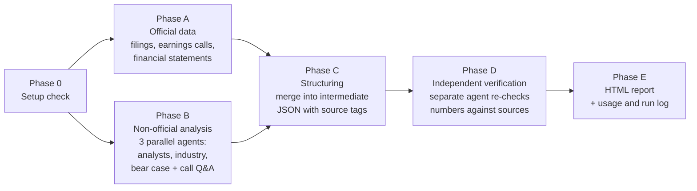

# Stock-Analysis

**English** | [繁體中文](README.zh-TW.md)

Claude Code skills that turn a single ticker into an **auditable** equity research report — one self-contained HTML file with charts, where every number links back to its source and has been through an independent verification pass.

- **`tw-stock-research`** — Taiwan-listed stocks (TWSE / TPEx)
- **`us-stock-research`** — US-listed stocks (SEC filings)

The goal is not a pretty write-up. It is a report you can check: if a number cannot be traced to a source, it is left out rather than estimated. Reports are written in Traditional Chinese.

## Quick start

1. Install [Claude Code](https://claude.com/claude-code).
2. Install Python 3.9+ and `pdftotext` (part of poppler):
   - macOS: `brew install poppler`
   - Ubuntu / Debian: `sudo apt install poppler-utils`
   - Windows: use WSL, then follow the Ubuntu steps.
3. Clone the repo:

   ```bash
   git clone https://github.com/xingyen0613/Stock-Analysis.git
   cd Stock-Analysis
   ```

4. Run the setup check. It lists what is missing and how to fix it:

   ```bash
   python3 .claude/hooks/check-setup.py
   ```

5. Add your keys as described in [API keys and credentials](#api-keys-and-credentials).
6. Start Claude Code in this folder (`claude`), accept the folder trust prompt, and type a ticker.

There is nothing to install globally. The skills, hooks and settings in `.claude/` load automatically when Claude Code opens this folder.

## Usage

Type a ticker or company name, optionally with a theme to dig into:

```text
3533
幫我看一下台積電 CoWoS
NVDA AI data center
```

If no theme is given, the skill picks the one or two themes that drive the latest quarter's revenue and says so at the top of the report. Reports are written to `reports/` (git-ignored).

## API keys and credentials

Taiwan reports work with no keys at all. US reports need one contact email.

| Item | Used by | Required? | How to get it | Where to put it |
|---|---|---|---|---|
| `SEC_UA_EMAIL` | US reports | **Yes** | Your own email. Not a key, no sign-up. [SEC policy](https://www.sec.gov/os/accessing-edgar-data) requires a contact email in the User-Agent; requests without one get HTTP 403. | `.claude/settings.local.json` |
| `FINMIND_TOKEN` | Taiwan reports | No | Free sign-up at [finmindtrade.com](https://finmindtrade.com/), then copy the API token from your member page. Without it, the anonymous quota can run out partway through a report. | `.claude/settings.local.json` |
| Massive API key | US reports | No | Free sign-up at [massive.com](https://massive.com) (formerly Polygon.io), then Dashboard → API Keys. Without it, the skill uses SEC XBRL for financials and Yahoo Finance for prices. | Claude Code MCP config (see below) |
| Telegram bot token and chat ID | "Send to TG" button on Taiwan reports | No | Create a bot with [@BotFather](https://t.me/BotFather). macOS only. | `~/.config/tw-stock-tg/config.json` |

**None of these go into the repo.** `.claude/settings.local.json` and `.env*` are git-ignored, the Massive key is stored in your Claude Code config (`~/.claude.json`), and the Telegram config lives in your home folder. The setup check only reports whether each value is set; it never prints them.

### `.claude/settings.local.json`

If the file does not exist yet, copy the template and fill in your values:

```bash
cp .claude/settings.local.json.example .claude/settings.local.json
```

If the file already exists (Claude Code creates it when you approve a permission), add your values to its `env` block and leave the rest alone:

```json
{
  "env": {
    "SEC_UA_EMAIL": "you@example.com",
    "FINMIND_TOKEN": "your-token"
  }
}
```

Restart Claude Code after editing; environment values load at startup. You can also ask Claude to add the email for you. For tokens, it is better to paste them into the file yourself than to paste them into the chat.

### Massive (Polygon) MCP

The US skill reads structured financials and prices through the [Massive MCP server](https://github.com/massive-com/mcp_massive). It is optional. To install it, you need [uv](https://docs.astral.sh/uv/) and a free API key:

```bash
uv tool install "mcp_massive @ git+https://github.com/massive-com/mcp_massive@v0.10.0"
```

```bash
claude mcp add massive -e MASSIVE_API_KEY=your_api_key_here -- mcp_massive
```

Massive also hosts the server at `https://mcp.massive.com`; see their [AI tools quickstart](https://massive.com/docs/ai-tools/quickstart). If your Claude account already has a Polygon or Massive connector, that works too.

### Telegram (optional)

The Taiwan report has a "send to TG" button. It converts the report to PDF on your machine with Google Chrome and posts it to a Telegram channel. Setup uses a macOS LaunchAgent; the steps are in [`telegram-sending.md`](.claude/skills/tw-stock-research/references/telegram-sending.md).

## Setup guard

You do not need to remember the steps above. The project checks for you at three points:

1. **When a session starts.** A `SessionStart` hook runs `check-setup.py`. If a required item is missing, Claude Code shows a one-line warning and Claude explains what to set and where. When everything is in place, the hook stays silent.
2. **Before each report.** Both skills start with a "Phase 0" check. A missing required item stops the run before any research begins. A missing optional item is mentioned once, and the run continues. The US skill also checks whether the Massive MCP tools are available and falls back to SEC XBRL and Yahoo Finance if they are not.
3. **When a script fails.** `fetch_sec.py` and the FinMind scripts say which value is missing and where to put it.

## What's inside

| Type | Path | Purpose |
|---|---|---|
| Skill | `.claude/skills/tw-stock-research/` | Taiwan stock report: workflow, report template, data scripts, references |
| Skill | `.claude/skills/us-stock-research/` | US stock report: workflow, SEC and AIHOT scripts, references |
| Skill | `.claude/skills/aihot/` | Third-party AIHOT Chinese AI news skill, used by the US report |
| Agent prompt | `*/agents/verifier.md` | Instructions for the Phase D verification subagent (one per report skill) |
| Hook | `.claude/hooks/check-setup.py` | `SessionStart`: setup check and onboarding; also runs by hand |
| Hook | `.claude/hooks/block-pdf-rasterize.py` | `PreToolUse`: blocks PDF-to-image conversion (an image page costs ~150x the tokens of its text) |
| Settings | `.claude/settings.json` | Registers both hooks; shared with everyone who clones the repo |
| Settings template | `.claude/settings.local.json.example` | Template for your personal, git-ignored settings |
| Report template | `tw-stock-research/assets/report-template.html` | Single-file HTML template with charts, notes and PDF export |
| References | `*/references/*.md` | Data sources and their pitfalls, report structure, AIHOT usage, Telegram setup |
| Glossary | `UBIQUITOUS_LANGUAGE.md` | Shared vocabulary for skills, prompts and reports |
| Run log | `runlog/runs.jsonl` | Problems hit on each run and how they were handled; each run appends a line |

Data scripts (all Python standard library):

| Script | What it does |
|---|---|
| `tw-stock-research/scripts/fetch_financials.py` | Quarterly financials from FinMind → `financials.json` |
| `tw-stock-research/scripts/fetch_pe_band.py` | P/E river chart data → `pe_band.json` (Taiwan via FinMind; US from a prepared JSON) |
| `tw-stock-research/scripts/pdf_chart_probe.py` | Reads chart labels from a PDF page by text coordinates instead of rendering it |
| `tw-stock-research/scripts/tg_bridge.py` | Local bridge that turns a report into PDF and posts it to Telegram |
| `tw-stock-research/scripts/token_report.py` | Token usage of a report run, split by main session and subagent |
| `us-stock-research/scripts/fetch_sec.py` | Saves recent 10-Q / 10-K / 8-K filings and exhibits as text |
| `us-stock-research/scripts/aihot_sync.py` | Keeps a local copy of AIHOT featured news |
| `us-stock-research/scripts/aihot_query.py` | Pulls news events for one ticker from the local AIHOT copy |
| `us-stock-research/scripts/runlog.py` | Appends to and summarizes `runlog/runs.jsonl` |

The project has no `CLAUDE.md` or `.claude/rules/`. Each skill keeps its rules in its own `SKILL.md`.

## How it works



Phases A and B run in subagents. The skills never write and research at the same time, so a number found later cannot be silently contradicted by a paragraph written earlier.

### Source tiers

Every number in a report carries a tier label. When sources conflict, the higher tier wins.

| Tier | Meaning | Taiwan examples | US examples |
|---|---|---|---|
| **L1 Official** | Published by the company | MOPS earnings-call decks, financial statements, monthly revenue | 10-K / 10-Q / 8-K and exhibits |
| **L1′ Derived** (US only) | Structured L1 data that links back to the filing | — | Massive (Polygon) or SEC XBRL financials |
| **L2 Analyst / research** | Professional forecasts and analysis | Broker notes, TrendForce, DIGITIMES | Analyst price targets |
| **L3 Media / community** | Second-hand or personal views | Financial media, forums | News, forums |

Three rules hold across both skills:

1. **If it can't be found, say so.** No filling gaps with industry averages, peer numbers, or interpolation.
2. **The official section holds L1 only.** Third-party estimates of undisclosed figures go in a separate, attributed section.
3. **Only verified items go in the main report.** Single-source breaking news goes in a "latest unverified" section.

### What a report contains

- Snapshot cards, latest-quarter financials, revenue breakdown by segment or product
- Official guidance, key management quotes, earnings-call Q&A highlights
- Analyst forecasts, an industry section with a CAGR comparison table, community views and the bear case
- Five charts: segment revenue mix, segment revenue, margins, revenue vs. EPS, and a P/E river chart
- Risks to watch, plus a source and verification log
- A personal notes area that is saved in the browser, with per-section PDF export (Taiwan template)

## Cost

These skills are thorough, and that makes them expensive. According to `runlog/runs.jsonl`, a full report takes about **10–37M tokens** and **30 minutes to 2 hours**. Most of that goes to reading filings and to the verification pass.

## Third-party components

- [`aihot`](.claude/skills/aihot/) is a skill by Virxact for the AIHOT Chinese AI news API, included under its [MIT License](.claude/skills/aihot/LICENSE). It uses an anonymous read-only API and needs no key.

## Disclaimer

Reports are compiled from public sources for research purposes only. They are not investment advice. Official figures are those published by the company and its regulators (MOPS for Taiwan, SEC EDGAR for the US).
