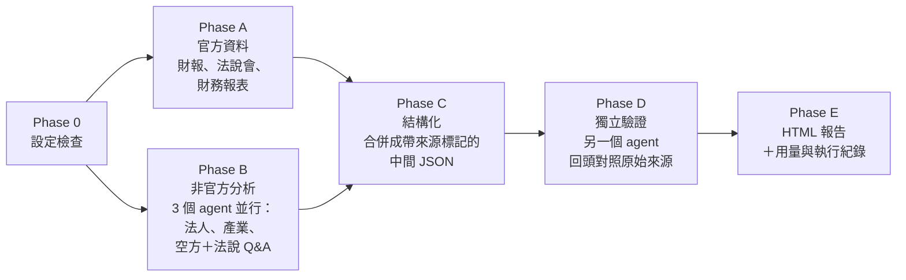

# Stock-Analysis

[English](README.md) | **繁體中文**

一組 Claude Code skills：丟一個股票代號，產出一份**可稽核**的個股研究報告。報告是單一 HTML 檔，含圖表；每個數字都連回原始來源，並經過一輪獨立驗證。

- **`tw-stock-research`** — 台股（上市／上櫃）
- **`us-stock-research`** — 美股（SEC 財報）

目標不是寫得漂亮，而是寫得能查：追不回來源的數字，寧可不寫，也不估。

## 快速開始

1. 安裝 [Claude Code](https://claude.com/claude-code)。
2. 安裝 Python 3.9 以上，以及 `pdftotext`（poppler 套件的一部分）：
   - macOS：`brew install poppler`
   - Ubuntu／Debian：`sudo apt install poppler-utils`
   - Windows：請用 WSL，再照 Ubuntu 的步驟。
3. 下載 repo：

   ```bash
   git clone https://github.com/xingyen0613/Stock-Analysis.git
   cd Stock-Analysis
   ```

4. 執行設定檢查。它會列出缺什麼、怎麼補：

   ```bash
   python3 .claude/hooks/check-setup.py
   ```

5. 照[金鑰與設定](#金鑰與設定)一節填好你的值。
6. 在這個資料夾啟動 Claude Code（`claude`），同意信任資料夾的提示，然後輸入股票代號。

不需要全域安裝任何東西。Claude Code 打開這個資料夾時，會自動載入 `.claude/` 裡的 skills、hooks 與設定。

## 使用方式

輸入股票代號或公司名稱，也可以加上想深入的產業主題：

```text
3533
幫我看一下台積電 CoWoS
NVDA AI data center
```

沒給主題的話，skill 會從最新一季營收自己挑 1–2 個主導主題，並在報告開頭說明。報告寫到 `reports/`（不進 git）。

## 金鑰與設定

台股報告完全不需要金鑰。美股報告需要一個聯絡信箱。

| 項目 | 用在 | 必要嗎 | 怎麼取得 | 放在哪裡 |
|---|---|---|---|---|
| `SEC_UA_EMAIL` | 美股報告 | **必要** | 填你自己的信箱，不是金鑰，不用申請。[SEC 規定](https://www.sec.gov/os/accessing-edgar-data)請求的 User-Agent 要帶聯絡信箱，沒帶會被回 HTTP 403。 | `.claude/settings.local.json` |
| `FINMIND_TOKEN` | 台股報告 | 選用 | 到 [finmindtrade.com](https://finmindtrade.com/) 免費註冊，在會員頁複製 API token。不設的話，匿名額度可能在報告中途用盡。 | `.claude/settings.local.json` |
| Massive API key | 美股報告 | 選用 | 到 [massive.com](https://massive.com)（原 Polygon.io）免費註冊，在 Dashboard → API Keys 取得。不設的話，財務改用 SEC XBRL、股價改用 Yahoo Finance。 | Claude Code 的 MCP 設定（見下方） |
| Telegram bot token 與 chat ID | 台股報告的「傳到 TG」按鈕 | 選用 | 用 [@BotFather](https://t.me/BotFather) 建 bot。僅支援 macOS。 | `~/.config/tw-stock-tg/config.json` |

**這些值都不會進 repo。** `.claude/settings.local.json` 與 `.env*` 已被 `.gitignore` 排除；Massive key 存在你的 Claude Code 設定（`~/.claude.json`）；Telegram 設定放在你的家目錄。設定檢查只回報「有沒有設」，不會印出值。

### `.claude/settings.local.json`

如果這個檔還不存在，複製範本再填值：

```bash
cp .claude/settings.local.json.example .claude/settings.local.json
```

如果這個檔已經存在（你在 Claude Code 核准過權限，它就會自動建立），把值加進它的 `env` 區塊，其他內容不要動：

```json
{
  "env": {
    "SEC_UA_EMAIL": "you@example.com",
    "FINMIND_TOKEN": "your-token"
  }
}
```

改完要重開 Claude Code，環境變數在啟動時才載入。信箱可以直接請 Claude 幫你加。token 建議自己貼進檔案，不要貼進對話。

### Massive (Polygon) MCP

美股 skill 透過 [Massive MCP server](https://github.com/massive-com/mcp_massive) 讀結構化財務與股價，這是選用的。安裝需要 [uv](https://docs.astral.sh/uv/) 與一把免費 API key：

```bash
uv tool install "mcp_massive @ git+https://github.com/massive-com/mcp_massive@v0.10.0"
```

```bash
claude mcp add massive -e MASSIVE_API_KEY=your_api_key_here -- mcp_massive
```

Massive 也提供託管版 `https://mcp.massive.com`，見他們的 [AI tools quickstart](https://massive.com/docs/ai-tools/quickstart)。如果你的 Claude 帳號已經有 Polygon 或 Massive connector，也可以直接用。

### Telegram（選用）

台股報告上有「傳到 TG」按鈕。它在你的電腦上用 Google Chrome 把報告轉成 PDF，再傳到 Telegram 頻道。設定會用到 macOS LaunchAgent，步驟見 [`telegram-sending.md`](.claude/skills/tw-stock-research/references/telegram-sending.md)。

## 防呆機制

上面的步驟不用背。專案會在 3 個時間點替你檢查：

1. **開新 session 時。** `SessionStart` hook 會跑 `check-setup.py`。缺必要項目時，Claude Code 會顯示一行警告，Claude 會說明要設什麼、設在哪裡。都設好了，hook 不會出聲。
2. **每次跑報告前。** 兩個 skill 都以「Phase 0」檢查開頭。缺必要項目就停下來，不會開始查資料。缺選用項目只提醒一次，然後照常跑。美股 skill 還會確認有沒有 Massive MCP 工具，沒有就改用 SEC XBRL 與 Yahoo Finance。
3. **腳本出錯時。** `fetch_sec.py` 與 FinMind 腳本會直接說缺哪個值、要放哪裡。

## 專案組成

| 類型 | 路徑 | 用途 |
|---|---|---|
| Skill | `.claude/skills/tw-stock-research/` | 台股報告：流程、報告範本、抓資料腳本、參考文件 |
| Skill | `.claude/skills/us-stock-research/` | 美股報告：流程、SEC 與 AIHOT 腳本、參考文件 |
| Skill | `.claude/skills/aihot/` | 第三方 AIHOT 中文 AI 資訊 skill，美股報告會用到 |
| Agent prompt | `*/agents/verifier.md` | Phase D 驗證 subagent 的指示（兩個報告 skill 各一份） |
| Hook | `.claude/hooks/check-setup.py` | `SessionStart`：設定檢查與引導；也可以手動執行 |
| Hook | `.claude/hooks/block-pdf-rasterize.py` | `PreToolUse`：擋掉把 PDF 轉成圖檔（一頁圖片的 token 約是文字的 150 倍） |
| 設定 | `.claude/settings.json` | 註冊上面兩個 hook；所有 clone 的人共用 |
| 設定範本 | `.claude/settings.local.json.example` | 個人設定的範本，複製後的檔案不進 git |
| 報告範本 | `tw-stock-research/assets/report-template.html` | 單檔 HTML 範本，含圖表、筆記區與 PDF 匯出 |
| 參考文件 | `*/references/*.md` | 資料來源與常見坑、報告結構、AIHOT 用法、Telegram 設定 |
| 術語表 | `UBIQUITOUS_LANGUAGE.md` | skills、prompt 與報告共用的術語 |
| 執行紀錄 | `runlog/runs.jsonl` | 每次產報告遇到的問題與處理方式；每跑一次新增一行 |

抓資料腳本（全部只用 Python 標準函式庫）：

| 腳本 | 做什麼 |
|---|---|
| `tw-stock-research/scripts/fetch_financials.py` | 從 FinMind 抓逐季財務 → `financials.json` |
| `tw-stock-research/scripts/fetch_pe_band.py` | 本益比河流圖資料 → `pe_band.json`（台股走 FinMind；美股吃整理好的 JSON） |
| `tw-stock-research/scripts/pdf_chart_probe.py` | 用文字座標讀 PDF 單頁的圖表標籤，不轉成圖片 |
| `tw-stock-research/scripts/tg_bridge.py` | 本機橋接服務：把報告轉 PDF 傳到 Telegram |
| `tw-stock-research/scripts/token_report.py` | 統計一次報告的 token 用量，按主對話與 subagent 拆分 |
| `us-stock-research/scripts/fetch_sec.py` | 把最近的 10-Q／10-K／8-K 與附件存成純文字 |
| `us-stock-research/scripts/aihot_sync.py` | 維護 AIHOT 精選的本地副本 |
| `us-stock-research/scripts/aihot_query.py` | 從 AIHOT 本地副本撈出某檔標的的消息事件 |
| `us-stock-research/scripts/runlog.py` | 寫入與彙整 `runlog/runs.jsonl` |

專案沒有 `CLAUDE.md` 或 `.claude/rules/`，規則都寫在各 skill 的 `SKILL.md` 裡。

## 運作方式



Phase A、B 在 subagent 執行。skill 不會邊查邊寫，所以後面查到的數字，不會被前面已經寫好的段落悄悄蓋掉。

### 來源分級

報告裡每個數字都帶等級標籤。來源衝突時，等級高的優先。

| 等級 | 定義 | 台股例子 | 美股例子 |
|---|---|---|---|
| **L1 官方** | 公司自己發布的 | 公開資訊觀測站法說會簡報、財報、月營收 | 10-K／10-Q／8-K 與附件 |
| **L1′ 官方衍生**（僅美股） | 第三方結構化的 L1，且帶得回原始 filing | — | Massive（Polygon）或 SEC XBRL 財務 |
| **L2 法人／研調** | 專業機構的財測與分析 | 券商報告、TrendForce、DIGITIMES | 分析師目標價 |
| **L3 媒體／社群** | 二手轉述或個人觀點 | 財經媒體、論壇 | 新聞、論壇 |

兩個 skill 共用三條原則：

1. **查不到就寫查不到。** 不用產業平均、同業數字或內插補缺口。
2. **官方章節只放 L1。** 第三方對未揭露數字的估算，放在另一個標明出處的章節。
3. **主報告只放驗證過的。** 單一來源的最新消息，放在「最新未驗證」區。

### 報告內容

- 快照卡片、最新一季財務、業務別或產品別營收拆解
- 官方財測、經營層重點發言、法說會 Q&A 重點
- 法人財測、產業章節（含 CAGR 對照表）、社群觀點與空方論述
- 五張圖：業務別營收占比、業務別營收、利潤率、營收與 EPS、本益比河流圖
- 觀察風險，以及來源與驗證紀錄
- 存在瀏覽器裡的個人筆記區，可逐章節匯出 PDF（台股範本）

## 成本

這兩個 skill 查得很細，所以很貴。依 `runlog/runs.jsonl`，一份完整報告約 **1,000–3,700 萬 token**、**30 分鐘到 2 小時**。大部分花在讀財報與驗證。

## 第三方元件

- [`aihot`](.claude/skills/aihot/) 是 Virxact 製作的 AIHOT 中文 AI 資訊 API skill，依其 [MIT License](.claude/skills/aihot/LICENSE) 收錄。它用匿名唯讀 API，不需要金鑰。

## 免責聲明

報告由公開資料彙整，僅供研究參考，不構成投資建議。官方數字以公司與主管機關公告為準（台股為公開資訊觀測站，美股為 SEC EDGAR）。
